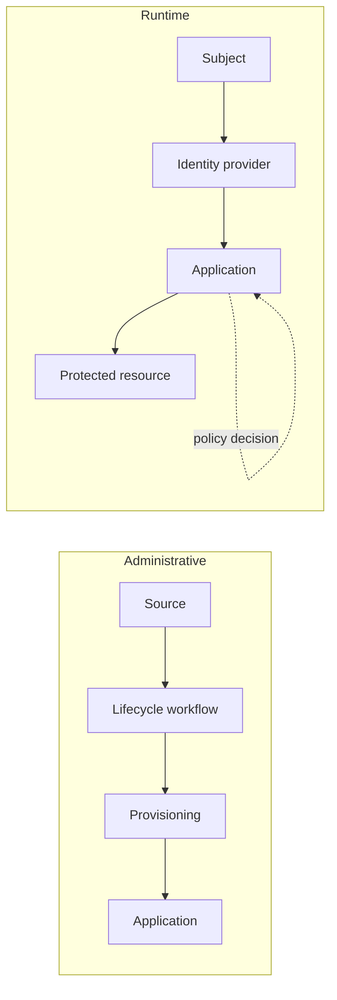

An IAM architecture is a set of responsibilities and trust relationships. One product may cover several responsibilities; several products may share one responsibility.

## A functional map

| Component | Primary responsibility |
| --- | --- |
| Authoritative source | Supplies trusted facts about a population or attribute. |
| Identity repository / directory | Stores and exposes identity and account information. |
| Identity provider | Authenticates subjects and issues identity assertions. |
| Authorization server | Issues access tokens according to an authorization framework. |
| Provisioning service | Applies identity and access changes to target systems. |
| Governance service | Supports requests, approvals, ownership, and access reviews. |
| Policy decision point | Evaluates an authorization request against policy. |
| Policy enforcement point | Allows or blocks the requested operation. |
| Privileged access service | Controls elevated access and, where applicable, sessions or secrets. |
| Audit and monitoring | Records events, supports investigation, and detects failures. |

## Follow two different flows

The **administrative flow** changes identities and access. A lifecycle event leads to account creation, an assignment, and reconciliation.

The **runtime flow** handles an actual request. A subject authenticates; an application receives an assertion or token; an enforcement point checks access to the requested resource.

The diagram shows responsibilities, not a mandatory network topology. Some requests use previously established sessions and do not contact the identity provider every time.

## Make trust boundaries visible

For every connection, identify who produces data, who consumes it, how trust is established, which identifiers are used, and how freshness is checked. A signed assertion still needs validation for the intended issuer, recipient, and time window.

## Questions for a first design

- Which components must be available for a new login?
- Where are resource-level permissions enforced?
- Can an application remain accessible after central disablement?
- Who detects a failed provisioning operation?
- How are emergency access and recovery handled?

See [a workforce reference architecture](workforce-reference.md) for a concrete starting point.
