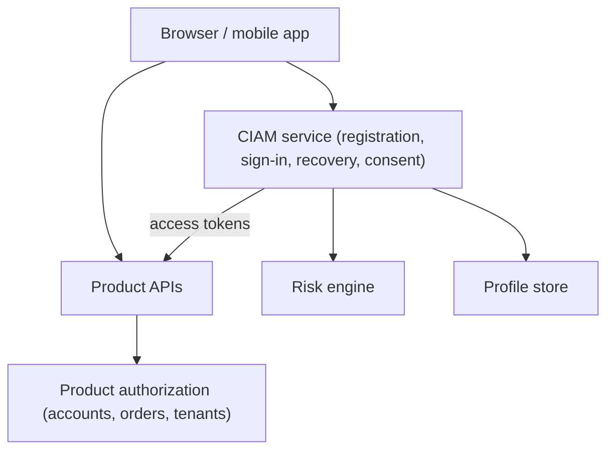

Customer IAM serves people who are not employees: customers, citizens, patients, students, or members. The building blocks are similar to workforce IAM, but the constraints are different.

## How customer identity differs

| Aspect | Workforce IAM | Customer IAM |
| --- | --- | --- |
| Source of identity | HR or a sponsor creates the record. | The person usually registers themselves. |
| Scale | Thousands to hundreds of thousands. | Up to hundreds of millions, with traffic spikes. |
| Devices | Often managed by the organization. | Unmanaged, shared, and diverse. |
| Support | Internal help desk with known users. | Public support channels, a target for social engineering. |
| Friction | Tolerated if required by policy. | Directly affects conversion and accessibility. |
| Privacy | Employment context. | Consent, marketing preferences, and data subject rights. |

## Registration

Decide what the account needs before collecting anything. Many products need only a verified contact channel at first; other attributes can be collected progressively when a feature requires them.

Common controls include rate limiting, bot detection, email or phone verification, and checks against disposable addresses. Identity proofing is needed only when a transaction depends on a real-world identity; see [identity assurance levels](../fundamentals/identity-assurance.md).

Avoid account enumeration: registration, sign-in, and recovery responses should not reveal whether an address is already registered, unless that trade-off is a deliberate product decision.

## Authentication

Passkeys offer phishing-resistant sign-in with low friction. Offer them alongside a fallback that is appropriate for your population. Social or external identity providers can reduce friction but create a dependency on that provider's account security and availability.

If passwords remain, follow current guidance: allow long passphrases, check against known-compromised passwords, do not impose arbitrary composition rules or periodic changes, and rate limit attempts. Protect against credential stuffing, which replays passwords leaked from other sites.

## Recovery is the real security boundary

Attackers target the weakest path to an account. If sign-in requires a passkey but recovery requires only access to an email inbox, the account is as strong as that inbox.

Design recovery with the same care as sign-in:

- Prefer multiple registered authenticators so loss of one is not a recovery event.
- Use recovery codes or a second registered channel rather than knowledge questions.
- Notify existing channels when authenticators or contact details change.
- Apply a cooling-off period or extra checks before high-risk actions after recovery.
- Give support staff a scripted, auditable process that cannot be bypassed by persuasion.

## Consent, privacy, and data rights

Customer identity data is personal data. Record what each attribute is for, which consent or legal basis covers it, and which applications receive it. Support export, correction, and deletion requests, and make sure deletion propagates to systems that received the data.

When users sign in to third-party applications with your identity service, show what will be shared and let users revoke that access later.

## Fraud and abuse signals

Account takeover, fake registrations, and promotion abuse are identity problems. Useful signals include impossible travel, new device plus sensitive action, many accounts per device, and authentication failures across many accounts from one source. Feed them into risk-based decisions such as step-up authentication, rather than only blocking.

## Architecture sketch

The CIAM service authenticates people and issues tokens. Product services still own business authorization, such as which orders a customer may view.

## References

- [OWASP Authentication Cheat Sheet](https://cheatsheetseries.owasp.org/cheatsheets/Authentication_Cheat_Sheet.html).
- [OWASP Credential Stuffing Prevention Cheat Sheet](https://cheatsheetseries.owasp.org/cheatsheets/Credential_Stuffing_Prevention_Cheat_Sheet.html).
- [NIST SP 800-63B-4](https://pages.nist.gov/800-63-4/sp800-63b.html) for password and authenticator requirements.
