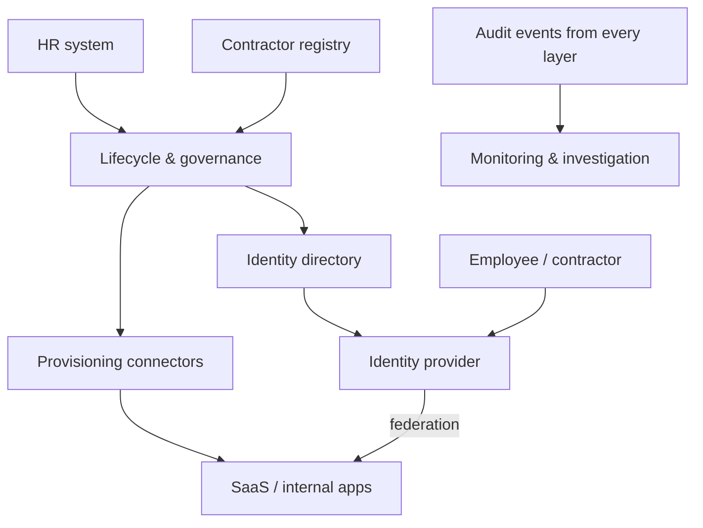

This vendor-neutral example supports employees and contractors accessing business applications. It is a starting point to adapt, not a production deployment blueprint.

## Logical design

The directory and identity provider may be part of one service. Governance and provisioning can also share a platform. Their responsibilities should remain explicit.

## Administrative behavior

1. A source announces a new or changed affiliation.
2. The lifecycle service correlates the record with a subject.
3. Policy determines baseline access; additional access may require approval.
4. Connectors create or update accounts and assignments.
5. Reconciliation verifies the resulting state and routes failures to an owner.

Contractor sponsorship and expiry should be modeled even if HR does not hold contractor records.

## Runtime behavior

An application redirects the user to the identity provider. The provider authenticates the user according to policy and returns a protocol-specific response. The application validates that response, establishes its own session, and enforces business authorization on each protected operation.

Federation may use [OIDC](../oauth-oidc/openid-connect.md) or [SAML](../standards/saml.md). Provisioning may use [SCIM](../standards/scim.md), a vendor API, or a controlled manual process.

## Design for failure

Define what happens when the identity provider is unavailable, a connector stops processing, an application ignores a disablement, or a source sends an incorrect termination event.

Provide monitored emergency access with narrow scope and regular exercises. Avoid an untested shared administrator password as the entire recovery strategy.

## Measure the architecture

Useful starting measures include time to usable access, time to confirmed revocation, failed connector operations, orphaned accounts, and applications without an accountable owner.

A high SSO coverage figure does not demonstrate that offboarding works. Test the full chain, including sessions and local access paths.
