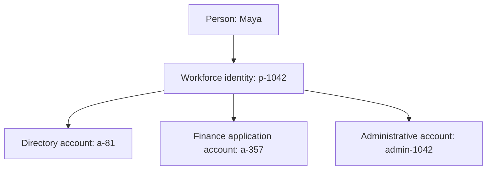

An identity, an account, and a credential describe different things. Keeping them separate makes onboarding, integration, and access reviews easier to reason about.

## Identity

A digital identity is a representation of a subject in a particular context. A subject may be a person, a service, a device, or another entity that interacts with a system.

The same person can have several contextual identities: employee, customer, and member of a professional community. Those contexts do not automatically need to be linked.

## Account

An account is a system-specific record through which a subject is represented or operates. A person might have an ordinary account, a separate administrative account, and accounts in several applications.

An account may contain a local identifier, status, profile attributes, and permission assignments. The number of accounts is therefore not the number of people.

## Credential and authenticator

In the NIST digital identity model, a credential binds an identity to one or more authenticators. An authenticator is something the claimant possesses and controls to authenticate, such as a cryptographic key or a password.

Everyday product terminology is less consistent: a vendor may call a password, certificate, API key, or token a “credential.” Document the meaning used by your system.

An access token is a means of presenting authorization to a resource server. Receiving a token does not turn every token into a person's primary identity record.

## One person, several representations

This example is an illustrative model, not a required schema. An application may use a federated identifier without provisioning a conventional local account.

## Modeling consequences

- Use stable internal identifiers; email addresses and display names can change.
- Represent the relationship between an identity and its accounts explicitly.
- Separate account status from employment status and authenticator status.
- Give service accounts an owner and a purpose, even when no person signs in with them.
- Avoid merging identities solely because they share an email address.

The result should let an operator answer “Which accounts belong to this subject?” without guessing from names.

## Next step

See how these entities fit into a [basic identity model](../identity-modeling/identity-model.md).

## Reference

[NIST SP 800-63-4 terminology](https://pages.nist.gov/800-63-4/sp800-63.html#definitions) defines digital identity, credential, and authenticator in a formal authentication context.
