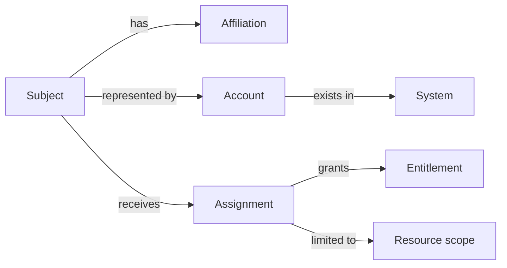

An identity model describes what exists in your domain and how it relates to access. A useful first version separates a subject, its accounts, its organizational relationships, and its access assignments.

## Start with entities

| Entity | Example | Why it matters |
| --- | --- | --- |
| Subject | Person `p-1042` | Provides a stable reference across systems. |
| Affiliation | Contractor at organization A | Explains a relationship and its duration. |
| Account | Finance account `a-357` | Represents access in a target system. |
| Resource | Project `r-204` | Identifies what is protected. |
| Entitlement | `expense:approve` | Describes an available unit of access. |
| Assignment | Subject → entitlement → scope | Records who receives which access and where. |

This is an illustrative domain model. It is not an industry-mandated database schema.

## Separate facts from decisions

“Maya works in Finance” is an identity attribute. “Finance analysts can read regional reports” is a policy. “Maya has the regional-report-reader assignment until December” is an access record.

Keeping these distinct helps explain why a policy change can affect access without changing Maya's employment record.

## Choose stable identifiers

Use a stable, non-reassigned identifier within a defined namespace. Store identifiers from external systems with their source, rather than assuming they are globally unique.

An email address is useful contact information. It is a fragile primary key because it can change or be reassigned. Names are even less reliable for matching records.

## Include time and ownership

An affiliation or assignment may have a start time, end time, source, owner, and reason. Distinguish “requested,” “approved,” and “successfully applied.” A target system can fail after an approval succeeds.

Consider a person who is simultaneously an employee and a customer. Define whether those contexts remain separate and which attributes may be shared.

## Questions to resolve

- Can one subject have multiple simultaneous affiliations?
- Can accounts be shared, and how will individual actions remain attributable?
- What happens when duplicate subjects are discovered?
- Which relationship determines who can approve access?

Continue with [sources and attributes](sources-and-attributes.md) to decide who owns each fact.
