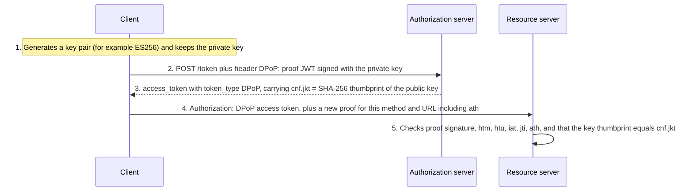

A bearer token works for anyone who holds it. Demonstrating Proof of Possession (DPoP, RFC 9449) binds tokens to a public/private key pair held by the client. A stolen DPoP-bound token is useless without the private key.

## How it works



## The proof JWT

```jsonc
// Header
{ "typ": "dpop+jwt", "alg": "ES256",
  "jwk": { "kty": "EC", "crv": "P-256", "x": "…", "y": "…" } }

// Payload
{
  "jti": "e1j3V_bKic8-LAEB",          // unique; servers can reject replays
  "htm": "GET",                       // HTTP method of this request
  "htu": "https://api.example.test/orders", // target URI without query and fragment
  "iat": 1792000000,                  // creation time; must be recent
  "ath": "fUHyO2r2Z3DZ53EsNrWBb0xWXoaNy59IiKCAqksmQEo", // hash of the access token (API calls only)
  "nonce": "eyJ7S_zG.eyJH0-Z.HX4w-7v" // when the server requires one
}
```

Each proof is valid only for one method, one URL, and a short time window, so an intercepted proof cannot be reused for another request.

## Server-provided nonces

A server can require a nonce to limit how far in advance proofs can be pre-generated. It returns a `DPoP-Nonce` header with error `use_dpop_nonce`; the client retries with that nonce in its proof. Nonces can be rotated over time.

## Binding the whole flow

- **Authorization code:** the client can send `dpop_jkt` (the key thumbprint) in the authorization request, binding the code to the key.
- **Refresh tokens:** for public clients, refresh tokens are bound to the DPoP key, so a stolen refresh token cannot be used elsewhere.
- **Metadata:** authorization servers advertise `dpop_signing_alg_values_supported`; clients can register `dpop_bound_access_tokens: true`; resource servers can declare `dpop_bound_access_tokens_required` in [Protected Resource Metadata](discovery-and-metadata.md).

## Errors

| Error | Where | Meaning |
| --- | --- | --- |
| `invalid_dpop_proof` | Token endpoint or API | Proof missing, malformed, wrong `htm`/`htu`, too old, or replayed. |
| `use_dpop_nonce` | Token endpoint or API | Retry with the provided `DPoP-Nonce`. |

APIs signal DPoP with `WWW-Authenticate: DPoP error="invalid_dpop_proof", algs="ES256"`.

## DPoP compared with mutual TLS

| Aspect | DPoP | Mutual TLS (RFC 8705) |
| --- | --- | --- |
| Layer | Application (HTTP headers). | Transport (TLS). |
| Works in browsers and SPAs | Yes, with WebCrypto keys. | Generally impractical. |
| Infrastructure | No PKI needed. | Certificates; often a PKI. |
| TLS termination at proxies | Unaffected. | Certificate must be forwarded securely. |
| Typical use | Public clients, mobile, SPAs, APIs at large. | Server-to-server, open banking, high assurance. |

## Limitations

- DPoP prevents **exfiltrated** tokens from being replayed elsewhere. It does not stop malicious code running inside the legitimate client from using the key, as with XSS in a browser. Use non-extractable WebCrypto keys and a strong content security policy.
- Servers need replay detection (`jti` caching) and reasonable clock tolerance.
- Every request requires a signing operation; usually negligible, but measure on constrained devices.

## References

- [OAuth 2.0 Demonstrating Proof of Possession (DPoP), RFC 9449](https://www.rfc-editor.org/rfc/rfc9449.html).
- [JSON Web Key (JWK) Thumbprint, RFC 7638](https://www.rfc-editor.org/rfc/rfc7638.html).
- [OAuth 2.0 Mutual-TLS, RFC 8705](https://www.rfc-editor.org/rfc/rfc8705.html).
- [OAuth 2.0 Security BCP, RFC 9700](https://www.rfc-editor.org/rfc/rfc9700.html), on sender-constrained tokens.
