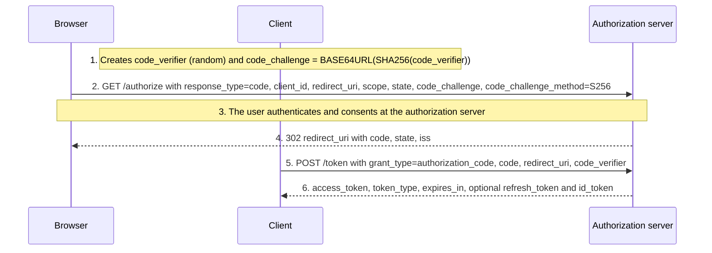

A **grant** is the way a client obtains an access token. A **client type** describes whether the client can keep a secret. A **client authentication method** is how a confidential client proves its identity at the token endpoint. These three choices determine most of an OAuth integration's security.

## Grant types at a glance

| Grant | `grant_type` value | Use it for | Status |
| --- | --- | --- | --- |
| Authorization code + PKCE | `authorization_code` | Users signing in to web, mobile, desktop, and SPA clients. | Recommended default. |
| Client credentials | `client_credentials` | A service acting on its own behalf. | Recommended for machine-to-machine. |
| Refresh token | `refresh_token` | Obtaining new access tokens without user interaction. | Recommended, with rotation or sender constraint for public clients. |
| Device authorization | `urn:ietf:params:oauth:grant-type:device_code` | TVs, CLIs, and devices with limited input. | Recommended where needed. |
| Token exchange | `urn:ietf:params:oauth:grant-type:token-exchange` | Swapping a token for another audience, scope, or actor. | Specialized. |
| JWT bearer | `urn:ietf:params:oauth:grant-type:jwt-bearer` | Exchanging a trusted signed assertion for a token. | Specialized. |
| CIBA | `urn:openid:params:grant-type:ciba` | Authenticating a user on a separate device, such as a call-center flow. | Specialized (OpenID). |
| Implicit | `response_type=token` | — | Not recommended (RFC 9700). |
| Resource owner password | `password` | — | Must not be used (RFC 9700). |

## Authorization code with PKCE

PKCE (RFC 7636) prevents a stolen authorization code from being redeemed by anyone who does not hold the `code_verifier`. Current guidance applies it to all clients, including confidential ones. Use `S256`; `plain` exists only for constrained legacy cases.

The `state` parameter protects the client against cross-site request forgery on its callback. The `iss` response parameter (RFC 9207) lets a client that talks to several authorization servers detect mix-up attacks.

## Client credentials

The client authenticates and receives a token for itself. No user is involved, so there is no refresh token or consent. Scope the client narrowly and prefer strong client authentication. See [giving a workload access to an API](../use-cases/workload-access.md).

## Refresh tokens

Refresh tokens allow long sessions with short-lived access tokens. They are powerful credentials:

- **Rotation:** each use returns a new refresh token and invalidates the previous one. Reuse of an old token signals theft and should revoke the whole token family.
- **Sender constraint:** bind refresh tokens to the client with [DPoP](dpop.md) or mutual TLS.
- **Lifetimes:** set an absolute maximum and an idle timeout aligned with the session policy.

RFC 9700 requires public clients to use either rotation or sender-constrained refresh tokens.

## Client types

| Type | Can keep a secret? | Examples | Consequence |
| --- | --- | --- | --- |
| Confidential | Yes | Server-side web app, backend service, [BFF](../patterns/backend-for-frontend.md). | Authenticates at the token endpoint. |
| Public | No | Single-page app in the browser, mobile app, desktop app, CLI. | Cannot authenticate; relies on PKCE, exact redirect URIs, and token binding. |

A secret embedded in a mobile app or JavaScript bundle is not a secret: anyone can extract it. Register such clients as public.

## Client authentication methods

The `token_endpoint_auth_method` client metadata names the method.

| Method | How it works | Strength | Notes |
| --- | --- | --- | --- |
| `client_secret_basic` | Shared secret in the HTTP Basic header. | Low–medium | Simple; the secret is sent on every request and stored by both sides. |
| `client_secret_post` | Shared secret in the request body. | Low–medium | Same as above; Basic is usually preferred. |
| `client_secret_jwt` | JWT signed with HMAC using the shared secret. | Medium | Secret is not sent, but both sides still hold it. |
| `private_key_jwt` | JWT signed with the client's private key (RFC 7523). | High | Authorization server holds only the public key; supports key rotation via `jwks_uri`. |
| `tls_client_auth` | Mutual TLS with a PKI-issued certificate (RFC 8705). | High | Needs certificate infrastructure; can also bind tokens. |
| `self_signed_tls_client_auth` | Mutual TLS with a registered self-signed certificate. | High | No CA needed; certificate registered in client metadata. |
| `none` | No authentication. | — | Public clients only. |

For new confidential clients, prefer `private_key_jwt` or mutual TLS. High-security profiles such as FAPI 2.0 do not allow shared secrets.

## Redirect URIs

Register redirect URIs exactly and compare them by exact string match. Wildcards and partial matches have caused many account-takeover vulnerabilities. Native apps follow RFC 8252; see [native and mobile apps](../patterns/native-apps.md).

## Choosing quickly

- A person uses the application → authorization code + PKCE.
- A backend calls an API for itself → client credentials with `private_key_jwt` or mTLS.
- A device cannot show a browser → device authorization grant.
- A service calls another service on behalf of a user → token exchange.

## References

- [OAuth 2.0, RFC 6749](https://www.rfc-editor.org/rfc/rfc6749.html) — sections 2 (clients), 4 (grants), and 6 (refresh).
- [PKCE, RFC 7636](https://www.rfc-editor.org/rfc/rfc7636.html).
- [OAuth 2.0 Security Best Current Practice, RFC 9700](https://www.rfc-editor.org/rfc/rfc9700.html).
- [JWT Profile for Client Authentication and Authorization Grants, RFC 7523](https://www.rfc-editor.org/rfc/rfc7523.html).
- [OAuth 2.0 Mutual-TLS, RFC 8705](https://www.rfc-editor.org/rfc/rfc8705.html).
- [Authorization Server Issuer Identification, RFC 9207](https://www.rfc-editor.org/rfc/rfc9207.html).
- [OpenID Connect CIBA Core](https://openid.net/specs/openid-client-initiated-backchannel-authentication-core-1_0.html).
- [IANA OAuth Parameters registry](https://www.iana.org/assignments/oauth-parameters/oauth-parameters.xhtml) — authoritative list of grant types, parameters, and authentication methods.
