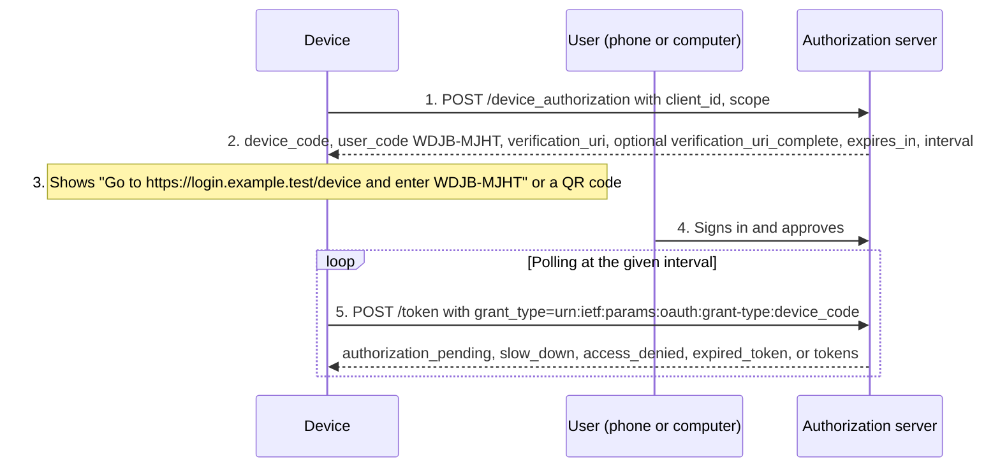

The core OAuth 2.0 framework is extended by a family of specifications. Each addresses a specific gap. You rarely need all of them, but knowing what exists helps you avoid building a custom mechanism.

## Map of extensions

| Need | Specification | Read |
| --- | --- | --- |
| Sign in on a device without a browser or keyboard | Device Authorization Grant, RFC 8628 | Below |
| Exchange one token for another, or act on behalf of a user | Token Exchange, RFC 8693 | Below |
| Bind tokens to a client key | DPoP, RFC 9449 | [DPoP](dpop.md) |
| Bind tokens to a client certificate | Mutual TLS, RFC 8705 | Below |
| Keep authorization requests out of the browser, sign them | PAR, RFC 9126; JAR, RFC 9101 | [PAR and JAR](par-and-jar.md) |
| Request fine-grained, structured permissions | RAR, RFC 9396 | [Rich Authorization Requests](rich-authorization-requests.md) |
| Request a token for a specific API | Resource Indicators, RFC 8707 | [Resource servers](resource-servers.md) |
| Discover servers and APIs | RFC 8414, RFC 9728 | [Discovery and metadata](discovery-and-metadata.md) |
| Require stronger authentication for an API call | Step-up, RFC 9470 | [Resource servers](resource-servers.md) |
| Authenticate a user on another device | OpenID CIBA | Below |
| Apply current security practice | RFC 9700; OAuth 2.1 | [Threats and mitigations](oauth-security.md) |

## Device authorization grant (RFC 8628)

The device must respect the polling `interval` and increase it on `slow_down`.

**Risk:** device-code phishing. An attacker starts a flow and persuades a victim to enter the code, then receives tokens for the victim's account. Show the client's name and requested access on the approval page, restrict the grant to clients that need it, and keep codes short-lived.

## Token exchange (RFC 8693)

A client presents a token and receives another one at the token endpoint:

| Parameter | Meaning |
| --- | --- |
| `grant_type` | `urn:ietf:params:oauth:grant-type:token-exchange` |
| `subject_token`, `subject_token_type` | The token representing the subject, for example an access token. |
| `actor_token`, `actor_token_type` | Optional: the token of the party acting on the subject's behalf. |
| `audience`, `resource` | The target service for the new token. |
| `scope` | Requested, usually reduced, scope. |
| `requested_token_type` | For example `urn:ietf:params:oauth:token-type:access_token`. |

Uses include downscoping a token for a downstream service ([authorization in APIs](../patterns/api-authorization.md)), **impersonation** (the new token represents the user), and **delegation** (the new token carries an `act` claim naming the actor, as for services and [AI agents](../use-cases/ai-agent-mcp.md)). The authorization server's exchange policy is the security boundary.

## Mutual TLS (RFC 8705)

RFC 8705 provides two things: **client authentication** with a TLS client certificate (`tls_client_auth`, `self_signed_tls_client_auth`), and **certificate-bound tokens**, where the token contains `cnf.x5t#S256`, the hash of the client certificate. The resource server checks that the TLS connection uses the same certificate. Compare with DPoP in [DPoP](dpop.md).

## JWT bearer grant (RFC 7523)

A client presents a signed JWT assertion, for example issued by a trusted identity system, and receives an access token. The same RFC defines `private_key_jwt` client authentication. Validate assertions strictly: issuer, audience, expiry, and one-time use.

## Client-Initiated Backchannel Authentication (CIBA)

In CIBA, the client starts authentication without redirecting the user's browser. The OpenID provider contacts the user on an authentication device, such as a banking app, and the client receives tokens by polling, ping, or push. Typical uses are call centers and point-of-sale payments.

## OAuth 2.1 and security profiles

OAuth 2.1 consolidates OAuth 2.0 with the security lessons published since: PKCE for authorization-code flows, exact redirect URI matching, no bearer tokens in query strings, refresh token protection for public clients, and removal of the implicit and resource owner password credentials grants. Check its current status on the IETF datatracker; the practices it reflects are already recommended by RFC 9700.

For high-risk APIs such as open banking, the OpenID Foundation's FAPI 2.0 Security Profile combines PAR, PKCE, sender-constrained tokens, and strong client authentication into a single, formally analyzed profile.

## References

- [Device Authorization Grant, RFC 8628](https://www.rfc-editor.org/rfc/rfc8628.html).
- [Token Exchange, RFC 8693](https://www.rfc-editor.org/rfc/rfc8693.html).
- [Mutual-TLS client authentication and certificate-bound tokens, RFC 8705](https://www.rfc-editor.org/rfc/rfc8705.html).
- [JWT Profile for Client Authentication and Authorization Grants, RFC 7523](https://www.rfc-editor.org/rfc/rfc7523.html).
- [OpenID Connect CIBA Core](https://openid.net/specs/openid-client-initiated-backchannel-authentication-core-1_0.html).
- [OAuth 2.1 draft](https://datatracker.ietf.org/doc/draft-ietf-oauth-v2-1/).
- [FAPI 2.0 Security Profile](https://openid.net/specs/fapi-security-profile-2_0-final.html).
