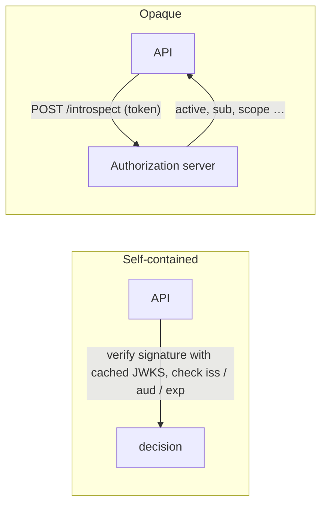
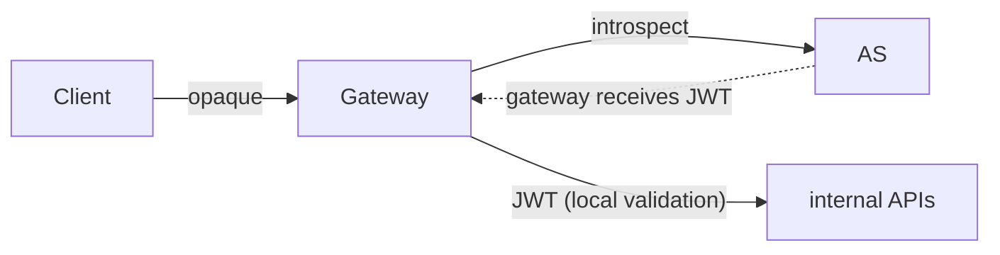

An access token can carry its information **by value** (a self-contained token, usually a signed JWT) or **by reference** (an opaque random string that points to state held by the authorization server). OAuth deliberately leaves this choice to the deployment.

## How each is validated

## Characteristics

| Aspect | Self-contained (JWT) | Opaque (reference) |
| --- | --- | --- |
| Validation | Local, using public keys. | Remote call to introspection. |
| Latency and AS load | Low; no call per request. | Higher; mitigated with caching. |
| Revocation | Effective only at expiry, unless the API checks extra state. | Immediate; the AS reports `active: false`. |
| Data freshness | Snapshot at issuance. | Current at introspection time. |
| Privacy | Payload readable by the client and anyone who intercepts it. | Reveals nothing. |
| Size | Can be large (claims, signatures). | Small, fixed length. |
| Offline/edge validation | Possible. | Requires connectivity to the AS. |
| Interoperability | Standard format (RFC 9068). | Standard introspection (RFC 7662). |

## When to choose which

**Self-contained tokens suit** high-volume internal APIs, edge or serverless validation, and environments where a few minutes of revocation delay is acceptable. Keep lifetimes short, for example 5 to 15 minutes.

**Opaque tokens suit** tokens exposed to third-party clients, scenarios needing immediate revocation, and cases where claims must not be visible to the client.

## Hybrid patterns

**Phantom token.** Clients receive an opaque token. An API gateway introspects it, asking for a JWT, and forwards that JWT to internal services. Outside, tokens reveal nothing and can be revoked; inside, services validate locally.

**Split token.** The token is a JWT, but the client receives only part of it (for example, the signature), and the gateway reconstructs the full JWT from a cache. This avoids an introspection call per request.

**Signed introspection.** RFC 9701 lets the introspection response itself be a signed JWT, useful when the resource server must prove what the AS asserted.

## Mitigating the revocation gap of JWTs

- Short access token lifetimes, with refresh tokens that can be revoked.
- Sender-constrained tokens ([DPoP](dpop.md) or mTLS), so a stolen token is not useful.
- Event-based revocation with [Shared Signals](../standards/shared-signals.md) for sessions.
- A deny list keyed by `jti` or `sid` for high-risk APIs, accepting the extra lookup.

## Common mistakes

- Clients parsing access tokens and depending on their claims. The format may change; clients should use the ID token or UserInfo for user data.
- Putting entire permission sets in tokens, producing headers too large for proxies.
- Caching introspection results longer than the token's remaining lifetime, or across different audiences.
- Assuming revoking a refresh token immediately invalidates outstanding JWT access tokens.

## References

- [JWT Profile for OAuth 2.0 Access Tokens, RFC 9068](https://www.rfc-editor.org/rfc/rfc9068.html).
- [OAuth 2.0 Token Introspection, RFC 7662](https://www.rfc-editor.org/rfc/rfc7662.html).
- [JWT Response for OAuth Token Introspection, RFC 9701](https://www.rfc-editor.org/rfc/rfc9701.html).
- [OAuth 2.0 Security BCP, RFC 9700](https://www.rfc-editor.org/rfc/rfc9700.html), on access token privilege restriction.
- [Curity: The Phantom Token Pattern](https://curity.io/resources/learn/phantom-token-pattern/) and [The Split Token Pattern](https://curity.io/resources/learn/split-token-pattern/), which describe these patterns.
