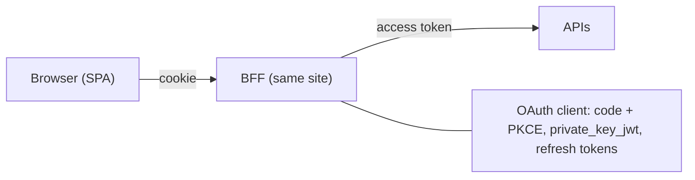

A single-page application (SPA) runs in the browser, where any successful cross-site scripting (XSS) attack can read JavaScript-accessible data, including tokens. The IETF draft *OAuth 2.0 for Browser-Based Applications* compares three architectures and recommends the most secure one for sensitive applications: the backend for frontend.

## Three architectures

| Pattern | OAuth client | Where tokens live | Browser holds |
| --- | --- | --- | --- |
| Backend for frontend (BFF) | Server-side, confidential | Server only | An `HttpOnly` session cookie |
| Token-mediating backend | Server-side, confidential | Access token sent to the browser; refresh token on the server | An access token in memory |
| Browser-based OAuth client | The SPA, public | Browser | Access and refresh tokens |

## How a BFF works

1. The SPA calls `/bff/login`; the BFF starts an authorization code flow with PKCE as a confidential client.
2. After the callback, the BFF stores tokens server-side (or encrypted in a cookie) and sets a session cookie.
3. The SPA calls APIs through the BFF (`/bff/api/...`) with the cookie. The BFF attaches the access token and refreshes it when needed.
4. `/bff/user` returns the profile claims the SPA needs for display; `/bff/logout` ends the session and the OP session.

## Securing the cookie and the BFF

- Cookie attributes: `__Host-` prefix, `Secure`, `HttpOnly`, `SameSite=Strict` or `Lax`, `Path=/`. See [cookies and sessions](cookies-and-sessions.md).
- **CSRF protection:** require a custom header such as `X-CSRF: 1` on API calls. Browsers send custom headers cross-origin only after a CORS preflight, which the BFF refuses for foreign origins. Combine with `SameSite`.
- Deploy the SPA and the BFF on the same site to avoid third-party cookie restrictions.
- Restrict the proxy to the APIs and paths the SPA needs; an open proxy is a vulnerability.

## Advantages and drawbacks

| Pattern | Advantages | Drawbacks |
| --- | --- | --- |
| BFF | Tokens never reach JavaScript; confidential client; strongest option. | Requires a server component; all API traffic goes through it; session state to manage. |
| Token-mediating backend | Refresh token protected; APIs called directly from the browser. | Access tokens exposed to XSS; still needs a backend. |
| Browser-based client | No backend; simple deployment. | Tokens exposed to XSS; public client; refresh tokens must rotate or be DPoP-bound. |

## What a BFF does not solve

XSS remains dangerous: malicious script can still send requests through the BFF while the user's page is open. The BFF prevents token **exfiltration** and long-term misuse, not in-session abuse. Keep a strict content security policy and sanitize output.

## When a pure SPA client is acceptable

For low-risk applications, a browser-based client can be acceptable with: authorization code + PKCE, tokens kept in memory rather than `localStorage`, short-lived access tokens, refresh token rotation or [DPoP](../oauth-oidc/dpop.md) with non-extractable keys, and a strong CSP.

## Implementations

Examples, not endorsements: [Duende BFF](https://docs.duendesoftware.com/bff/) for .NET, the [Curity Token Handler](https://curity.io/resources/learn/token-handler-overview/), [Spring Cloud Gateway TokenRelay](https://docs.spring.io/spring-cloud-gateway/reference/spring-cloud-gateway-server-webflux/gatewayfilter-factories/tokenrelay-factory.html), and [oauth2-proxy](https://oauth2-proxy.github.io/oauth2-proxy/).

## References

- [OAuth 2.0 for Browser-Based Applications (IETF draft)](https://datatracker.ietf.org/doc/draft-ietf-oauth-browser-based-apps/).
- [OAuth 2.0 Security BCP, RFC 9700](https://www.rfc-editor.org/rfc/rfc9700.html).
- [OWASP Cross-Site Request Forgery Prevention Cheat Sheet](https://cheatsheetseries.owasp.org/cheatsheets/Cross-Site_Request_Forgery_Prevention_Cheat_Sheet.html).
- [OWASP HTML5 Security Cheat Sheet — local storage](https://cheatsheetseries.owasp.org/cheatsheets/HTML5_Security_Cheat_Sheet.html#local-storage).
