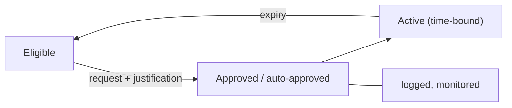

Standing access is access that exists whether or not anyone is using it. Every standing privilege is available to an attacker who compromises the account, at any time. Just-in-time (JIT) access replaces it with access that is granted for a task and expires on its own.

## The pattern

1. A person or workload is **eligible** for a role but does not hold it.
2. They **request activation**, with a reason, a ticket reference, and a duration.
3. Policy **approves** automatically for low-risk cases, or requires a human approver.
4. Access is **active** for the requested window and is logged.
5. Access **expires** automatically, without depending on someone remembering to remove it.

## Variants

| Variant | How it works |
| --- | --- |
| Eligible role activation | A role assignment is enabled for a period and then disabled. |
| Temporary group membership | The user is added to a group with an expiry time. |
| Ephemeral accounts or credentials | A short-lived account, certificate, or database credential is created per session. |
| Brokered session | The user never receives the credential; a broker opens the session for them. |

Ephemeral credentials go furthest: there is no persistent privileged credential to steal.

## Zero standing privilege

Zero standing privilege (ZSP) is the goal in which no identity holds high-impact privileges permanently. In practice, organizations approach it gradually, starting with the most powerful roles, and keep a small number of monitored [emergency access](../processes/emergency-access.md) accounts as an exception.

## Design considerations

**Activation must be fast and reliable.** If elevation takes twenty minutes during an outage, people will ask for permanent access. Measure activation time and the availability of the elevation service.

**Choose sensible durations.** Long enough to finish a task, short enough to limit exposure. Allow extension with a new justification.

**Propagation delay.** Some systems cache permissions or tokens. Removing a role may not end an existing session or token immediately; see [sessions and revocation](../processes/sessions-and-revocation.md).

**Approval fatigue.** If every activation requires a human, approvers will stop reading. Use auto-approval with strong authentication and monitoring for routine low-risk elevation, and reserve human approval for high-impact roles.

**Re-authentication.** Require a fresh, phishing-resistant authentication when activating privilege, so a stolen session cannot be elevated silently.

## What to log

Who requested, the justification, who approved, the role and scope, start and end times, and what was done during the window. This record is also strong evidence for audits.

## Keep learning

JIT is a core technique of [privileged access management](../capabilities/privileged-access.md) and applies equally to [non-human identities](../identity-modeling/non-human-identities.md).

## References

- [NIST SP 800-53 Rev. 5, AC-2(2) Automated Temporary and Emergency Account Management and AC-6 Least Privilege](https://csrc.nist.gov/pubs/sp/800/53/r5/upd1/final).
- [NIST SP 800-207: Zero Trust Architecture](https://csrc.nist.gov/pubs/sp/800/207/final), on per-session access decisions.
