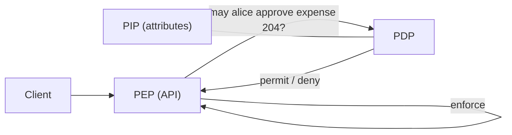

As authorization rules grow, scattering `if` statements across services makes them hard to review, test, and change consistently. Externalized authorization moves the decision into a dedicated component while the application keeps enforcing it.

## The reference roles

| Role | Responsibility | Example |
| --- | --- | --- |
| PEP — policy enforcement point | Intercepts the request, asks for a decision, and enforces it. | API middleware or a gateway plugin. |
| PDP — policy decision point | Evaluates policy and returns permit or deny. | A policy engine service or library. |
| PIP — policy information point | Supplies attributes the PDP needs. | Directory, HR data, resource metadata. |
| PAP — policy administration point | Where policy is written, reviewed, and published. | A Git repository and CI pipeline. |

These roles come from the XACML architecture and remain a useful vocabulary even when XACML itself is not used.

## What a decision request contains

A decision request generally describes four things: the **subject** (who), the **action** (what operation), the **resource** (which object), and the **context** (time, device, risk). The OpenID AuthZEN working group defines a standard Authorization API in exactly these terms so that enforcement points and decision engines from different vendors can interoperate.

## Common engines and languages

| Option | Character |
| --- | --- |
| XACML 3.0 | OASIS XML standard with a complete attribute-based model; verbose but precise. |
| Open Policy Agent (Rego) | General-purpose policy engine, widely used for APIs, Kubernetes, and infrastructure. |
| Cedar | Policy language designed for application authorization, with analyzable semantics. |
| Relationship-based systems | Zanzibar-inspired services storing relationship tuples and answering “check” queries. |

The choice depends on the model you need (attributes, relationships, or both), latency requirements, and who will write and review policies.

## Treat policy as code

Policy that grants access deserves the same discipline as application code:

- Keep it in version control with review and approval.
- Write tests with positive and negative cases, including edge cases such as missing attributes.
- Deploy through a pipeline with the ability to roll back.
- Log the policy version used for each decision, so an audit can reproduce it.

## Design considerations

**Latency and availability.** A remote PDP adds a network call to every protected request. Options include sidecars, embedded libraries, and caching of decisions. Decide explicitly what happens if the PDP is unreachable; for sensitive writes, fail closed.

**Data freshness.** The PDP is only as current as its attributes. A cached role that was removed an hour ago may still grant access.

**Filtering lists.** “Which documents may Alice see?” is harder than “may Alice see document 7?”. Some engines support partial evaluation or list queries; otherwise the application must filter results.

**Enforcement still lives in the application.** A PDP decides; if the application forgets to ask, nothing is enforced.

## Keep learning

Combine this with [RBAC, ABAC, and relationships](rbac-and-abac.md) and [authorization in APIs](api-authorization.md).

## References

- [OASIS XACML 3.0](https://docs.oasis-open.org/xacml/3.0/xacml-3.0-core-spec-os-en.html).
- [Open Policy Agent documentation](https://www.openpolicyagent.org/docs/latest/).
- [Cedar policy language](https://www.cedarpolicy.com/).
- [OpenID AuthZEN Working Group](https://openid.net/wg/authzen/).
- [NIST SP 800-162: Guide to ABAC](https://csrc.nist.gov/pubs/sp/800/162/upd2/final).
