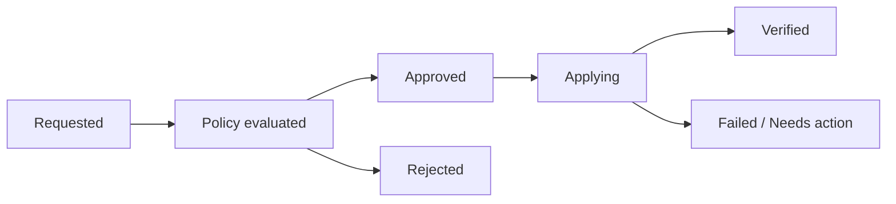

An access request proposes a change. An access review asks whether existing access remains appropriate. Both need enough context for a person or policy to make a meaningful decision.

## A useful request record

Capture the subject, requested resource, action or role, business reason, duration, and resource owner. Add any policy constraints, such as separation of duties or contractor eligibility.

Avoid showing only an opaque group name. A reviewer should understand what joining that group actually allows.

## Separate approval from fulfillment

An illustrative request lifecycle is:

An approved request is not evidence that the account was provisioned. Store fulfillment status and verify the target system's result.

Record who decided, when, and on what basis. Automated approval also needs an identifiable policy and an explanation.

## Review access with context

Reviewers may need the access purpose, owner, last relevant activity where available, assignment source, expiry, conflicts, and the consequences of removal.

An unused permission is a useful signal, not definitive proof that it is unnecessary. Emergency access may be intentionally rare. A frequently used permission can still be inappropriate.

Define how uncertain decisions are escalated and how revocations are completed. Measuring only the percentage of completed review forms can hide failed removals.

## Make the scope explicit

A manager review can check whether access fits a person's job. A resource owner can judge access to a particular application. A privileged-access review may need a specialist. Select the decision maker according to the risk and required knowledge.

Choose review frequency according to the resource and risk. There is no universal interval that makes every entitlement safe.

## Evidence and useful measures

Keep the reviewed snapshot, reviewer identity, decision, rationale when required, and the confirmed implementation of any change.

Useful measures include overdue decisions, assignments without owners, exceptions past their end date, and revocations that failed to reach their target. Use findings to improve the access model, rather than repeatedly reviewing the same avoidable exceptions.
