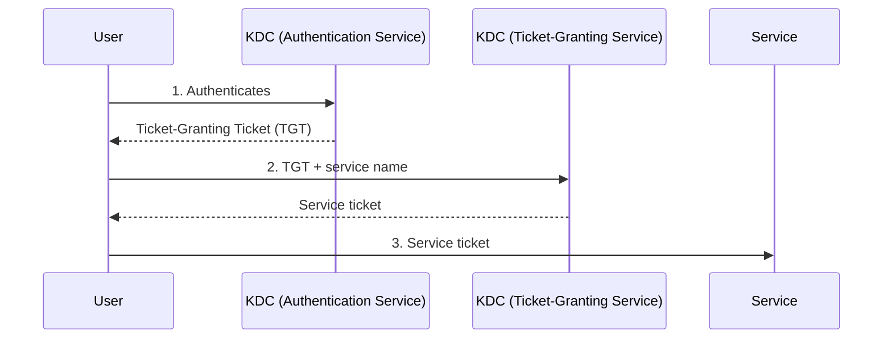

Web standards such as OIDC and SAML dominate new applications, but many organizations still run on a directory accessed with LDAP and a network authentication system based on Kerberos. Active Directory combines both. Understanding them matters for integration, migration, and security.

## LDAP: reading and writing a directory

The Lightweight Directory Access Protocol (LDAP) version 3 lets clients search and modify a hierarchical directory. Each entry has a distinguished name (DN), such as:

```text
uid=maya,ou=people,dc=example,dc=test
```

Entries have object classes and attributes such as `cn`, `mail`, and `memberOf`. Applications commonly use LDAP to look up users and groups, and sometimes to authenticate a user by attempting a **bind** with their password.

Security considerations:

- **Protect the connection.** Use LDAPS or StartTLS. A simple bind sends the password to the server, so it must never travel unencrypted.
- **Prevent LDAP injection.** Escape user input placed in search filters, as with SQL.
- **Use a narrowly scoped service account** for application lookups, with read access only to what the application needs.
- **Prefer federation for new applications.** An application that validates passwords against LDAP sees every user's password; one that uses OIDC or SAML never does.

## Kerberos: tickets instead of passwords

Kerberos version 5 authenticates users and services on a network using tickets issued by a trusted Key Distribution Center (KDC).



The user's password is used once to obtain the TGT; afterwards, tickets prove identity to services without resending the password. Services are identified by service principal names (SPNs). This is what enables seamless single sign-on inside a Windows domain.

## Common attacks on directories

Directories are prime targets because they hold the keys to the whole environment.

| Attack | Idea | Mitigation direction |
| --- | --- | --- |
| Kerberoasting | Request service tickets and crack weak service account passwords offline. | Long random service account passwords or managed service accounts. |
| Golden ticket | Forge TGTs using the stolen `krbtgt` account key. | Protect domain controllers; rotate `krbtgt` twice after compromise. |
| Pass-the-hash / pass-the-ticket | Reuse captured credential material without the password. | Limit privileged logons to hardened hosts; credential protection features. |
| NTLM relay | Relay a legacy challenge-response authentication to another service. | Restrict NTLM; require signing and channel binding. |

## Hybrid identity

Many organizations synchronize an on-premises directory with a cloud identity provider. That synchronization is a privileged path: compromise of the sync service or of the on-premises directory can spread to the cloud. Treat these components as tier-zero assets, alongside the identity provider itself.

When migrating applications away from LDAP and Kerberos, inventory which applications bind directly, which use Kerberos, and which still allow NTLM. Each needs a separate plan.

## References

- [LDAP Technical Specification Road Map, RFC 4510](https://www.rfc-editor.org/rfc/rfc4510.html) and [LDAP protocol, RFC 4511](https://www.rfc-editor.org/rfc/rfc4511.html).
- [Kerberos V5, RFC 4120](https://www.rfc-editor.org/rfc/rfc4120.html).
- [MITRE ATT&CK T1558: Steal or Forge Kerberos Tickets](https://attack.mitre.org/techniques/T1558/).
- [OWASP LDAP Injection Prevention Cheat Sheet](https://cheatsheetseries.owasp.org/cheatsheets/LDAP_Injection_Prevention_Cheat_Sheet.html).
