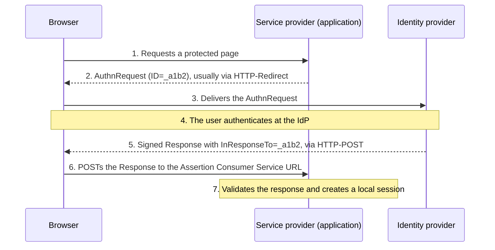

Security Assertion Markup Language (SAML) 2.0 provides an XML-based framework for exchanging assertions. In common enterprise web SSO deployments, an identity provider (IdP) authenticates a person and a service provider (SP) consumes an authentication assertion.

## The common browser interaction

In a service-provider-initiated sign-in, an application sends an authentication request toward the identity provider. After the required authentication, a SAML response is delivered to the application, which validates it and creates a local session.

In an **IdP-initiated** sign-in, the user starts at the identity provider's portal and an unsolicited response arrives at the application. There is no request for the response to match, so `InResponseTo` cannot protect against an injected or replayed response. Accept IdP-initiated sign-in only when it is needed, and then rely strictly on the other checks below.

Specific bindings, profiles, and initiation modes determine the details. “Supports SAML” does not mean every combination is supported.

## Bindings, profiles, and identifiers

A **binding** maps SAML messages onto a transport:

| Binding | How the message travels | Typical use |
| --- | --- | --- |
| HTTP-Redirect | Deflated and encoded in a URL query string; signature as separate query parameters. | Small messages such as `AuthnRequest`. |
| HTTP-POST | Base64-encoded in an auto-submitted HTML form. | Responses carrying signed assertions. |
| HTTP-Artifact | A short reference in the browser; the message is fetched over a back channel. | Keeping the assertion out of the browser. |
| SOAP | Direct server-to-server exchange. | Artifact resolution, back-channel logout. |

A **profile** combines messages and bindings for a use case. The Web Browser SSO profile is the one most applications implement.

The subject of an assertion is a `NameID` with a format, such as `persistent` (an opaque, stable, per-SP identifier), `transient` (a one-time value), or `emailAddress`. A persistent identifier is the safest account key. An email address can change or be reassigned.

## Assertions and trust

An assertion can communicate authentication information, in an `AuthnStatement` with an authentication context, and attributes, in an `AttributeStatement`. Its recipient needs to establish the trusted issuer and validate the applicable signature, audience, destination, timing, and request relationship.

| Check | What to verify |
| --- | --- |
| Signature | The response or assertion is signed by a key from the IdP's trusted metadata, and the signed element is the one you process. |
| Issuer | `Issuer` equals the expected IdP entity ID. |
| Audience | `AudienceRestriction` contains this SP's entity ID. |
| Recipient and destination | `Destination` and `SubjectConfirmationData/@Recipient` equal this SP's Assertion Consumer Service URL. |
| Time window | `NotBefore` and `NotOnOrAfter`, with a small clock-skew allowance. |
| Request relationship | `InResponseTo` matches an outstanding request from this browser session. |
| Replay | Assertion IDs are remembered until they expire, so the same assertion is not accepted twice. |

XML processing and signature validation have important implementation details. Use a maintained SAML library and the relevant profile rather than implementing validation from this overview.

## Attacks to know

| Attack | Idea | Mitigation |
| --- | --- | --- |
| XML signature wrapping | The attacker moves the signed element and inserts an unsigned assertion that the application processes instead. | Process only the element whose signature was verified; use a maintained library; reject unexpected document structures. |
| Unsigned or partially signed responses | The application accepts assertions without a valid signature. | Require a signature on the assertion or the whole response, as the profile demands. |
| Replay | A captured response is posted again. | Short validity, `InResponseTo`, and an ID cache. |
| XML parser abuse | External entities or deeply nested documents read files or exhaust memory. | Disable DTDs and external entities; limit document size. |
| Comment and canonicalization tricks | XML comments inside a `NameID` change how the value is read after the signature check. | Use patched libraries and read text values consistently. |

## Metadata and key rotation

Metadata describes information such as entity identifiers, endpoints, bindings, and keys. Trusting metadata and rotating signing certificates need an operational process.

Exchange metadata through a trusted channel, or fetch it from a URL and verify its signature. To rotate a signing certificate, publish the new key alongside the old one, wait until every SP has refreshed its metadata, switch signing, and then remove the old key. An expired or unannounced certificate change is a common cause of SSO outages.

## Account mapping is a design decision

An application might receive a subject identifier and organizational attributes. Decide which stable identifier links that assertion to a local account, and what happens when an attribute changes.

An unverified email match can connect the wrong local account. A display name should not function as an account-correlation key.

## Keep provisioning separate

SAML sign-in does not, by itself, define a complete joiner, mover, leaver process. An application may create an account during login, but that does not guarantee account removal or the termination of an existing session later.

Use [federation and provisioning](../patterns/federation-and-provisioning.md) to design the full integration.

## Logout

SAML Single Logout (SLO) sends `LogoutRequest` messages to each session participant, through the browser or over a back channel. Front-channel SLO stops at the first participant that fails or is unreachable, so many deployments support only local logout. Check logout behavior explicitly instead of inferring it from SSO support, and see [sessions, tokens, and revocation](../processes/sessions-and-revocation.md).

## References

- [OASIS SAML 2.0 Core](https://docs.oasis-open.org/security/saml/v2.0/saml-core-2.0-os.pdf).
- [OASIS SAML 2.0 Bindings](https://docs.oasis-open.org/security/saml/v2.0/saml-bindings-2.0-os.pdf).
- [OASIS SAML 2.0 Profiles](https://docs.oasis-open.org/security/saml/v2.0/saml-profiles-2.0-os.pdf).
- [OASIS SAML 2.0 Metadata](https://docs.oasis-open.org/security/saml/v2.0/saml-metadata-2.0-os.pdf).
- [OWASP SAML Security Cheat Sheet](https://cheatsheetseries.owasp.org/cheatsheets/SAML_Security_Cheat_Sheet.html).
