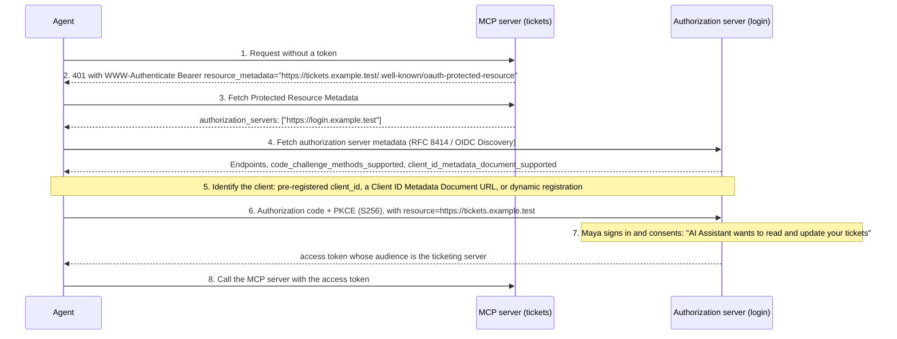

Maya uses an AI assistant that can call tools. Her company exposes its ticketing system as a Model Context Protocol (MCP) server so the assistant can search and update tickets on her behalf. The agent must act with Maya's authority, limited to what she approved, and the ticketing system must know it is talking to an agent.

The MCP authorization specification builds on OAuth 2.1 and the discovery standards described in this handbook.

## Roles

| MCP role | OAuth role |
| --- | --- |
| MCP server (ticketing tools) | Resource server |
| MCP client (inside the AI application) | OAuth client, usually public |
| Company identity provider | Authorization server |
| Maya | Resource owner |

## Discovery and authorization

See [discovery and metadata](../oauth-oidc/discovery-and-metadata.md) for steps 2 to 4. The client must refuse to continue if the authorization server metadata does not advertise PKCE support.

## How the agent identifies itself

An MCP client and an MCP server often have no prior relationship, so the client needs a way to obtain a `client_id`. The specification lists three mechanisms, in this order of preference:

1. **Pre-registration.** Use a `client_id` the client already holds for this authorization server.
2. **Client ID Metadata Documents (CIMD).** The `client_id` is an HTTPS URL, such as `https://assistant.example.test/oauth/client.json`, that serves the client's metadata (`client_name`, `redirect_uris`, and so on). The authorization server fetches and validates the document, and advertises support with `client_id_metadata_document_supported`.
3. **Dynamic client registration (RFC 7591).** Kept as a fallback for backwards compatibility.

CIMD avoids creating a new registration for every client and server pair, but the authorization server takes on new risks. Fetching an arbitrary URL invites server-side request forgery, and a client using `localhost` redirect URIs can be impersonated by anyone who points at its metadata URL. Show the redirect host on the consent screen and apply a trust policy for unknown domains.

## Security rules that matter

**Audience-bound tokens.** The `resource` parameter (RFC 8707) makes the token valid only for the ticketing MCP server. The server must reject tokens issued for any other audience.

**No token passthrough.** If the ticketing MCP server needs to call another API, it must not forward Maya's token. It obtains its own token for that API, for example through [token exchange](../oauth-oidc/oauth-extensions.md), which can record the delegation chain in an `act` claim. Forwarding tokens creates a confused-deputy problem and bypasses the downstream API's controls.

**Least privilege for the agent.** Request narrow scopes such as `tickets.read` and `tickets.comment`. Destructive actions such as closing many tickets deserve separate scopes, explicit confirmation from Maya, or [step-up](../oauth-oidc/resource-servers.md).

**Consent that names the agent.** The consent screen should show which application is acting, so Maya can distinguish the assistant from other clients and revoke it later.

**Audit both identities.** The ticketing system should log the user (`sub`) and the client (`client_id` or `act`), so that “Maya did it” and “the agent did it on Maya's behalf” are distinguishable.

## Risks specific to agents

| Risk | Mitigation |
| --- | --- |
| Prompt injection makes the agent take unintended actions | Narrow scopes, confirmation for sensitive actions, server-side authorization on every call. |
| Over-broad standing tokens | Short-lived access tokens, refresh tokens bound to the client, easy revocation. |
| Malicious tool servers | Allow lists of trusted MCP servers; validate metadata and issuers. |
| Unclear accountability | Delegation claims and audit logs that record the actor. |

## References

- [Model Context Protocol: Authorization (2025-11-25)](https://modelcontextprotocol.io/specification/2025-11-25/basic/authorization) — check for later revisions of the specification.
- [OAuth Client ID Metadata Document (IETF draft)](https://datatracker.ietf.org/doc/draft-ietf-oauth-client-id-metadata-document/).
- [OAuth 2.0 Protected Resource Metadata, RFC 9728](https://www.rfc-editor.org/rfc/rfc9728.html).
- [Resource Indicators, RFC 8707](https://www.rfc-editor.org/rfc/rfc8707.html).
- [OAuth 2.0 Token Exchange, RFC 8693](https://www.rfc-editor.org/rfc/rfc8693.html).
- [OWASP Top 10 for LLM Applications](https://genai.owasp.org/llm-top-10/).
