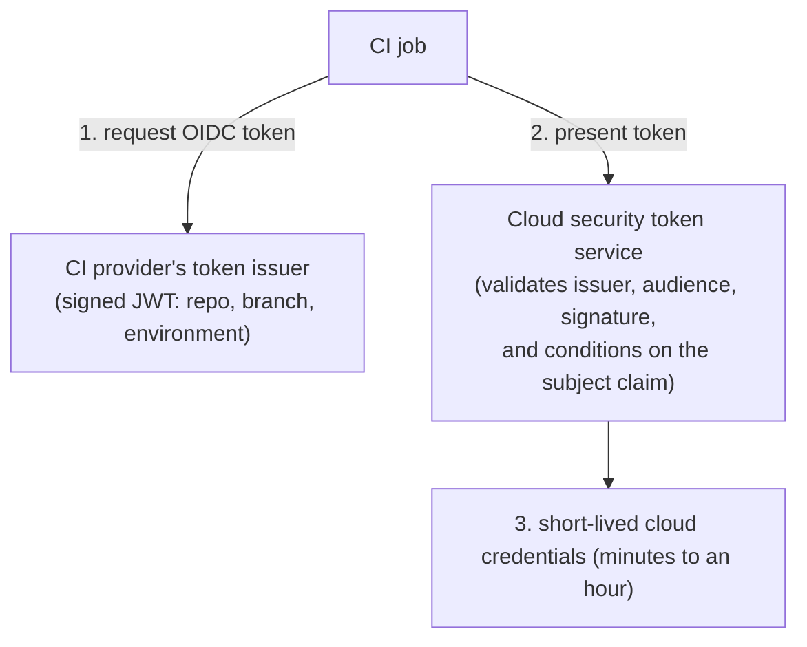

A team deploys an application to a cloud account from a CI/CD pipeline. The traditional setup stores a long-lived cloud access key as a pipeline secret. That key works from anywhere, often for years, and leaks through logs, forks, or compromised build dependencies.

Workload identity federation replaces the stored key with a short-lived credential issued for each run.

## How it works

1. The CI platform issues a signed OIDC token describing the job: the repository, the branch or tag, the environment, and the workflow.
2. The job presents this token to the cloud provider's security token service.
3. The cloud provider validates it against a configured trust and returns temporary credentials for a specific role.

No secret is stored in the pipeline. The credential expires shortly after the job.

## The trust condition is the security boundary

The cloud trust must say exactly which jobs may assume the role. With GitHub Actions, for example, the token's `sub` claim can look like `repo:example-org/payments:environment:production`.

A safe condition matches the organization, repository, and branch or protected environment. A dangerous one matches only the organization, or uses a wildcard that allows any repository, fork, or branch to deploy to production.

Also check the `aud` claim, so a token minted for another purpose cannot be reused here.

## Scope the role

Give the deployment role permission to update this application only, not to administer the account. Use separate roles for planning and applying infrastructure changes, and for each environment.

Protect the production path in the CI platform as well: require reviews on the protected branch and approval on the production environment, since the identity of the job is derived from them.

## What remains to protect

Federation removes stored keys, but not all risk:

- A malicious change merged into the trusted branch can still deploy. Code review and branch protection remain controls.
- Compromised build dependencies run inside the trusted job. Pin and verify them.
- Logs should never print the temporary credentials.

## Test it

- A run from the main branch in the production environment succeeds.
- A run from a feature branch or a fork is refused by the cloud provider.
- A token with the wrong audience is refused.
- The credentials no longer work after their expiry.

## Keep learning

This applies the ideas in [workload and non-human identities](../identity-modeling/non-human-identities.md) and [giving a workload access to an API](workload-access.md).

## References

- [GitHub Docs: OpenID Connect](https://docs.github.com/en/actions/concepts/security/openid-connect).
- [OpenID Connect Core 1.0](https://openid.net/specs/openid-connect-core-1_0.html) for ID token structure and validation.
- [SPIFFE](https://spiffe.io/) for a platform-neutral approach to workload identity.
