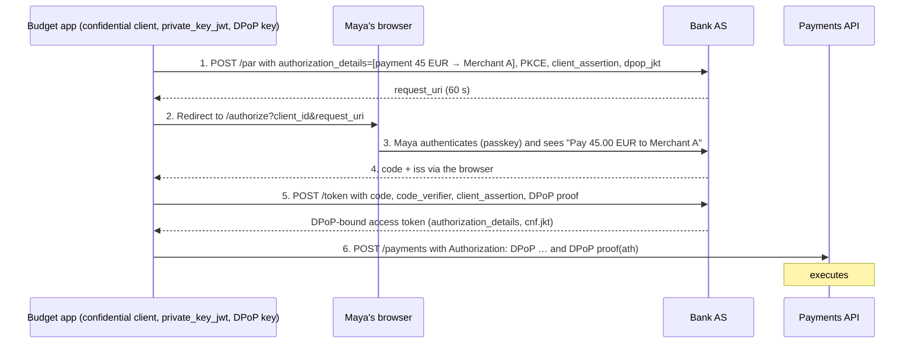

A budgeting app wants to pay 45.00 EUR from Maya's bank account to a merchant. The bank exposes a payments API protected by OAuth. Classic scopes such as `payments` are too broad: Maya should approve **this** payment, the bank must be sure the request came from the registered app, and a stolen token must be useless.

This walkthrough combines [PAR](../oauth-oidc/par-and-jar.md), [RAR](../oauth-oidc/rich-authorization-requests.md), [DPoP](../oauth-oidc/dpop.md), and strong client authentication, similar to what the FAPI 2.0 Security Profile requires.

## The flow

## Why each piece is there

| Mechanism | Threat addressed |
| --- | --- |
| `private_key_jwt` client authentication | Impersonation of the app; no shared secret to steal. |
| PAR | Tampering with the amount or creditor in the browser; early client authentication. |
| RAR `authorization_details` | Over-broad consent; the token authorizes exactly one payment. |
| PKCE and `iss` | Code interception, injection, and mix-up. |
| Passkey authentication | Phishing of Maya's credentials. |
| DPoP-bound token | Replay of a stolen access token. |
| Short token lifetime | Limited exposure if everything else fails. |

## What the payments API checks

1. DPoP proof: signature, `htm`, `htu`, `iat`, `jti`, `ath`, and key thumbprint equal to `cnf.jkt`.
2. Token: issuer, audience (`https://payments.example.test`), expiry.
3. `authorization_details`: type `payment_initiation`, and that the submitted payment matches amount, currency, and creditor exactly.
4. Single use: the authorization has not been consumed already.

If the app tries to submit 450.00 EUR, or a different creditor, the API rejects it even though the token is valid.

## Variations

- **Step-up:** for amounts above a threshold, the API returns `insufficient_user_authentication` (RFC 9470) and the app restarts with stronger `acr_values`.
- **Recurring payments:** a different `type` with limits, frequency, and an end date, plus revocation by the user.
- **Decoupled approval:** with CIBA, Maya approves on her banking app while paying at a shop terminal.

## Test cases

- Changing any field of the pushed request after PAR is impossible; a modified front-channel parameter is ignored.
- A token used without a DPoP proof, or with a proof from another key, is rejected.
- A second submission with the same authorization is rejected.
- The consent screen displays the amount and creditor exactly as executed.

## References

- [FAPI 2.0 Security Profile](https://openid.net/specs/fapi-security-profile-2_0-final.html).
- [RFC 9126 (PAR)](https://www.rfc-editor.org/rfc/rfc9126.html), [RFC 9396 (RAR)](https://www.rfc-editor.org/rfc/rfc9396.html), [RFC 9449 (DPoP)](https://www.rfc-editor.org/rfc/rfc9449.html).
- [RFC 9470 (Step-up)](https://www.rfc-editor.org/rfc/rfc9470.html).
